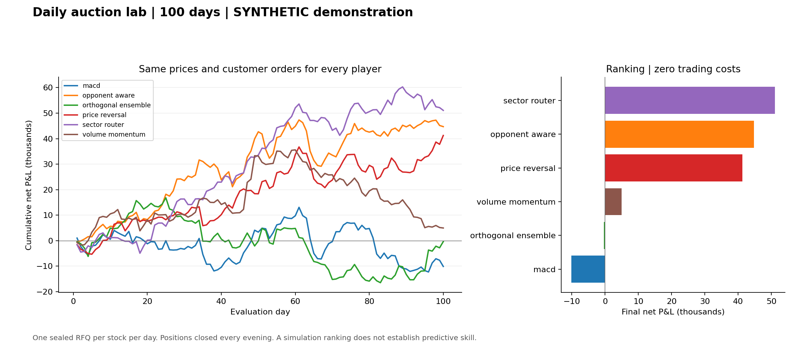
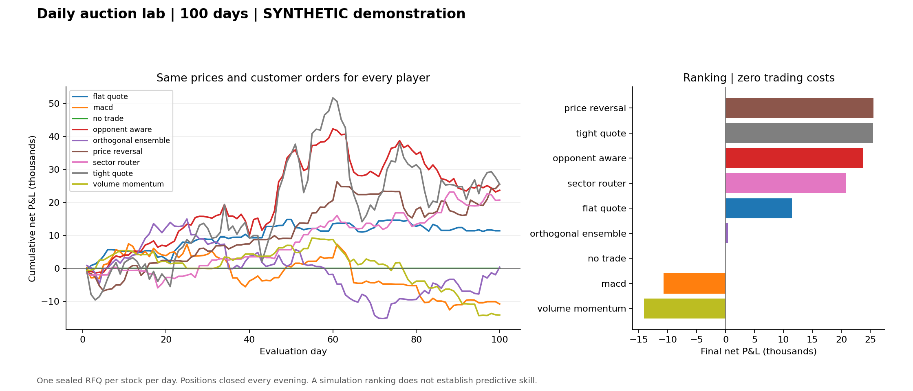

# 4. Results, attribution and limitations

## Experiment definition

Both ordinary tournaments use seed 7, nine synthetic stocks, 180 initial warm-up dates, 100 evaluation dates, a 126-date rolling regression window and 1,000,000 starting capital per player. Costs are zero. All inventory closes daily. The same prices, random customer directions and requested sizes are used for both rosters; executions and subsequent policy histories can differ.

Version 0.4 reproduces the previous six-player Colab leaderboard and the previous nine-player 100-day daily P&L records. The six-player ordinary/stress experiments were generated with this release. Nine-player reference results, including the stress and twenty repeated runs, were retained from version 0.3; a full ordinary nine-player run was replayed with version 0.4 to verify unchanged outcomes.

## Single-seed comparison

| Strategy | Six-player P&L | Nine-player P&L |
|---|---:|---:|
| `sector_router` | 51,060.52 | 20,731.60 |
| `opponent_aware` | 44,693.89 | 23,699.55 |
| `price_reversal` | 41,234.53 | 25,561.45 |
| `volume_momentum` | 4,965.63 | -14,076.04 |
| `orthogonal_ensemble` | -357.03 | 401.37 |
| `macd` | -10,106.59 | -10,745.16 |
| `flat_quote` | Not entered | 11,436.45 |
| `tight_quote` | Not entered | 25,507.36 |
| `no_trade` | Not entered | 0.00 |





These are two different competitive games. Removing three names from a nine-player chart would not recover the six-player result. In particular, tight quotes can receive price priority and exhaust customer demand that would otherwise reach a different dealer.

## What explains the observed profit?

For a signed fill $q$ at price $p$, opening reference $O$ and closing price $C$:

$$q(C-p)=\underbrace{q(O-p)}_{\text{entry price improvement}}
+\underbrace{q(C-O)}_{\text{signed price movement}}.$$

The code names these terms `spread_pnl` and `price_pnl`. Entry price improvement is measured relative to the open, not necessarily a captured exchange spread; it can be negative for a directional quote. With the default zero costs their sum is net P&L. The six-player attribution is:

| Player | Entry price improvement | Signed price movement | Net profit |
|---|---:|---:|---:|
| `sector_router` | 16,084.29 | 34,976.23 | 51,060.52 |
| `opponent_aware` | 21,655.48 | 23,038.41 | 44,693.89 |
| `price_reversal` | 16,210.20 | 25,024.34 | 41,234.53 |
| `volume_momentum` | 19,165.25 | -14,199.62 | 4,965.63 |
| `orthogonal_ensemble` | 7,277.17 | -7,634.20 | -357.03 |
| `macd` | 16,849.43 | -26,956.01 | -10,106.59 |

- **Sector router:** Its leading profit is supported by positive contributions from both components. This describes this realization. It does not establish that the preselected technology/MACD, commodities/volume and financials/reversal mapping works in real markets.
- **Opponent-aware:** Its entry-price component is larger than the router's, but its signed price-movement component is smaller. It chooses against an estimated distribution, which need not be calibrated, and uses a different quantity allocation. Profit differences are not a clean causal measurement of the benefit of opponent modelling.
- **Price reversal:** Both components are positive in this run. In the nine-player game it leads tight quoting by only 54.09 cash units. The apparent winner is sensitive to competitive execution.
- **Volume momentum:** Entry price improvement offsets an unfavorable signed price-movement component in the six-player run. In the nine-player run it receives fewer shares and has negative overall profit.
- **Orthogonal ensemble:** Its six-player entry-price component is almost offset by adverse price movement. Whitening removes feature redundancy in the training sample, not trading risk, and supplies no guarantee of predictive information.
- **MACD:** Unfavorable price movement exceeds its positive entry-price component. This does not prove that MACD fails generally; the synthetic generator has no deliberately installed technical-indicator alpha.

In the nine-player tournament, `tight_quote` fills 768,884 shares, 45.61% of all requested customer volume. Its one-basis-point quotes are competitive and produce much larger exposure than the fixed eight-basis-point benchmark. More fills can help ordinary-flow profit but can amplify informed-flow losses.

## Twenty additional nine-player seeds

Seeds 1007–1026 each generate a fresh 280-date synthetic market and a 100-day nine-player tournament. This table excludes the ordinary seed-7 run and the stress run. Win share counts the fraction of tournaments won, splitting ties if any occur.

| Player | Mean P&L | Median P&L | Win share |
|---|---:|---:|---:|
| `tight_quote` | 17,215.38 | 27,955.46 | 50% |
| `opponent_aware` | 10,488.77 | 14,331.78 | 10% |
| `flat_quote` | 7,382.70 | 6,648.44 | 10% |
| `macd` | 5,056.59 | 6,057.66 | 0% |
| `price_reversal` | 3,956.69 | 3,659.40 | 10% |
| `sector_router` | 2,063.59 | 2,068.98 | 5% |
| `volume_momentum` | 2,044.21 | -1,715.03 | 5% |
| `no_trade` | 0.00 | 0.00 | 0% |
| `orthogonal_ensemble` | -2,103.12 | 2,187.45 | 10% |

The single-seed winner is not the repeated-run leader: tight quoting has the highest mean, while price reversal wins only 10% of the repeated tournaments. No equivalent twenty-seed six-player study is included. Do not transfer the nine-player averages to the six-player game.

## Optional informed-customer stress

Each request has a 35% probability of using the future price direction to select its customer side. The other requests have random sides. Prices, requested quantities and latent random draws are the same as the ordinary run. Agents never receive the future closing price as an input.

| Player | Six-player stress P&L | Nine-player stress P&L |
|---|---:|---:|
| `sector_router` | -29,144.81 | -15,320.94 |
| `opponent_aware` | -64,215.50 | -50,330.58 |
| `price_reversal` | -44,736.81 | -8,590.48 |
| `volume_momentum` | -78,400.66 | -43,458.61 |
| `orthogonal_ensemble` | -113,761.22 | -75,865.36 |
| `macd` | -87,409.52 | -62,419.91 |
| `flat_quote` | Not entered | -10,081.11 |
| `tight_quote` | Not entered | -197,232.19 |
| `no_trade` | Not entered | 0.00 |

All trading strategies lose in both rosters. The six-player router is the least negative, not profitable. The nine-player no-trade benchmark wins at zero. Tight quoting's large customer exposure accompanies the largest nine-player stress loss. This is evidence about the chosen adverse-selection mechanism in this simulator, not a calibrated estimate of real informed trading.

## Reproduction and outputs

```bash
python -m auction_lab demo --players 6 --days 100 --seed 7 --stress --out runs/six
python -m auction_lab demo --players 9 --days 100 --seed 7 --stress --repetitions 20 --out runs/nine
```

| Output | Meaning |
|---|---|
| `leaderboard.csv`, `summary.json`, `RESULTS.md` | Ranking, settings, metrics and machine-readable status |
| `daily_pnl.csv`, `overview.png` | Daily/cumulative profit and final ranking |
| `synthetic_prices.csv` | Complete generated price history, including warm-up |
| `customer_orders.csv`, `quotes.csv`, `trades.csv` | Requests, approved quotes and actual fills/settlement |
| `predictions.csv` | Return forecasts for each stock/date |
| `opponent_decisions.csv` | Estimated/realized fills and profit, chosen prices and training cutoffs |
| `pnl_correlation.csv`, `forecast_correlation.csv` | Sample profit/forecast correlation, with undefined values blank |
| `whitening_diagnostics.json` | Past training transform and later covariance diagnostic |
| `paired_bootstrap.csv` | Descriptive daily paired-profit comparisons |
| `informed_stress/` | Matching adverse-customer experiment when requested |
| `repeated_runs.csv`, `repeated_summary.csv` | Extra seed-level records and aggregates when requested |

The paired bootstrap resamples five-day blocks of realized daily differences. The baseline is `sector_router` for six players and `flat_quote` when it is present. Intervals condition on the fitted policies and game realization; they do not refit models or correct for selecting a winner after observing the data.

Reference environment: Python 3.12.14, NumPy 2.3.5, pandas 2.2.3 and Matplotlib 3.10.8. Floating-point or chart-rendering details may differ across environments. `provenance.json` records this release's checks.

## Scope of conclusions

The simulator answers how policies perform under its explicit price, customer and execution assumptions. It does not establish a live-trading edge. There is no endogenous price impact, intraday re-quoting, queue position, funding interest or model of short-borrow availability. Historical CSV mode still assumes its RFQ execution model. The reported Sharpe ratio annualizes 100 daily observations and should not be treated as a precise long-run estimate.

A stronger empirical study would predeclare the universe and policies, separate chronological training/validation/test intervals, evaluate multiple market regimes and rosters, incorporate corporate actions and changing constituents, and test observed or calibrated execution and costs. These are research extensions, not completed results.
